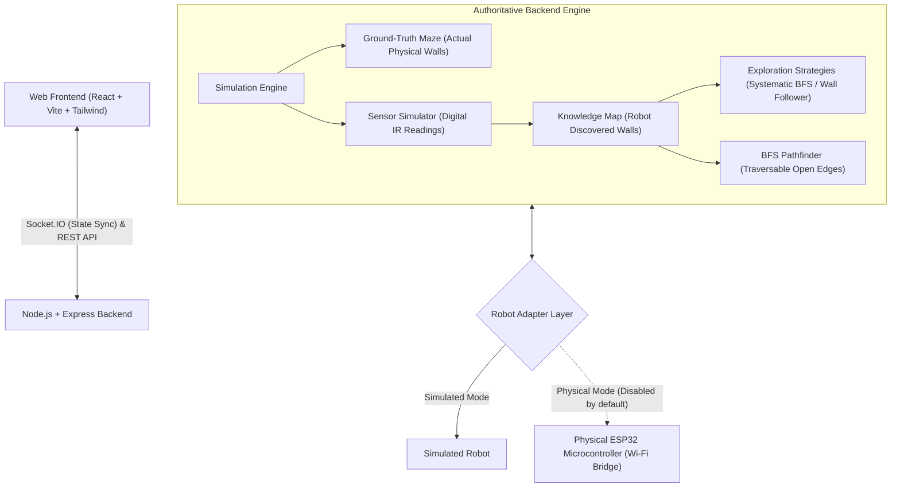

# System Architecture

## Autonomous Maze Solving and Mapping Robot

This document describes the software architecture of the full-stack Autonomous Maze Solving and Mapping Robot system.

---

## 1. Ground Truth vs. Robot Knowledge Map

A critical requirement of this autonomous robotics platform is the strict information isolation between ground-truth geometry and the robot's perception:

1. **Ground-Truth Maze (`GroundTruthMaze`)**:
   - Represents the physical reality of the labyrinth.
   - Contains all walls, outer boundaries, and open passages.
   - Used strictly by the simulation cycle to evaluate physical collision and compute IR sensor beam reflection.
   - **Never accessible to decision-making or exploration algorithms.**

2. **Robot Knowledge Map (`KnowledgeMap`)**:
   - Represents the accumulated internal map built by the robot.
   - Outer perimeter walls are known from the boundaries of the grid.
   - All interior wall segments begin in the `UNKNOWN` state.
   - Walls transition to `WALL` or `OPEN` only when the robot's directional IR sensors observe them from an adjacent cell.
   - Synchronizes shared edges between adjacent cells canonically to avoid duplicate or inconsistent state.
   - Visited cells are differentiated from fully explored cells (cells where all 4 walls have been resolved).

---

## 2. Canonical Wall Geometry

To eliminate inconsistencies where a wall is present in Cell A's EAST but missing from Cell B's WEST, walls are stored in two canonical 2D edge arrays:
- **`horizontalWalls`**: Dimension $(R + 1) \times C$. `horizontalWalls[r][c]` represents the wall above row $r$ for column $c$. Index $r=0$ and $r=R$ are outer boundaries.
- **`verticalWalls`**: Dimension $R \times (C + 1)$. `verticalWalls[r][c]` represents the wall to the left of column $c$ for row $r$. Index $c=0$ and $c=C$ are outer boundaries.

Any query or mutation on `(r, c, direction)` routes through these canonical edge matrices.

---

## 3. Simulation Cycle

Each simulation tick executes deterministically:
1. **Perception**: The robot queries its current position $(r, c)$ and orientation $\theta \in \{\text{NORTH}, \text{EAST}, \text{SOUTH}, \text{WEST}\}$.
2. **Sensor Emulation**: The ground-truth maze evaluates whether obstacles exist to the robot's relative `LEFT`, `FRONT`, or `RIGHT`.
3. **Polarity Mapping**: Raw digital values (`HIGH` or `LOW`) and interpreted states (`BLOCKED` or `CLEAR`) are produced based on the configured sensor polarity (`ACTIVE_LOW` default).
4. **Map Update**: Relative sensor observations are converted to absolute cardinal directions and recorded in the `KnowledgeMap`.
5. **Decision**: The active exploration strategy selects the next discrete movement action (`FORWARD`, `TURN_LEFT`, `TURN_RIGHT`, `REVERSE`, or `STOP`) based **strictly** on the `KnowledgeMap` and current sensor readings.
6. **Kinematic Validation**: The engine verifies that moving forward does not collide with a physical wall in the ground truth.
7. **State Mutation**: The robot's position or orientation is updated, visited status is marked, and telemetry is broadcast to connected clients via Socket.IO.
8. **Goal Verification**: If the robot arrives at the designated goal cell, exploration halts with status `GOAL_REACHED`.

---

## 4. Exploration Strategies

- **Systematic Exploration with Backtracking**:
  - Prioritizes directly adjacent unvisited cells.
  - When facing dead ends or fully explored local pockets, executes a Breadth-First Search on known traversable `OPEN` cells to identify the nearest unexplored frontier.
  - Automatically backtracks out of dead ends without looping infinitely.
- **Left-Hand Wall Follower**:
  - Tries Left $\rightarrow$ Front $\rightarrow$ Right $\rightarrow$ Turnaround.
- **Right-Hand Wall Follower**:
  - Tries Right $\rightarrow$ Front $\rightarrow$ Left $\rightarrow$ Turnaround.
- **Loop & Deadlock Detection**:
  - Tracks visited state tuples $(row, col, direction)$ and step limits to abort repeated cycles safely.

---

## 5. Breadth-First Search (BFS) Pathfinding

Once sufficient exploration has occurred, the BFS pathfinder calculates the guaranteed shortest path from the robot's current cell to the goal cell:
- Graph vertices: Visited grid cells.
- Graph edges: Adjacent cells where the connecting wall is confirmed `OPEN` in the `KnowledgeMap`.
- Uses a FIFO queue with parent pointers to reconstruct the optimal sequence of cell coordinates.
- Deconstructs the cell coordinates into discrete physical robot actions (`FORWARD`, `TURN_LEFT`, `TURN_RIGHT`) taking current orientation into account.
- Incomplete Map Protection: If the goal is not yet reachable via confirmed `OPEN` corridors, reports a clean unreachable status without failing.

